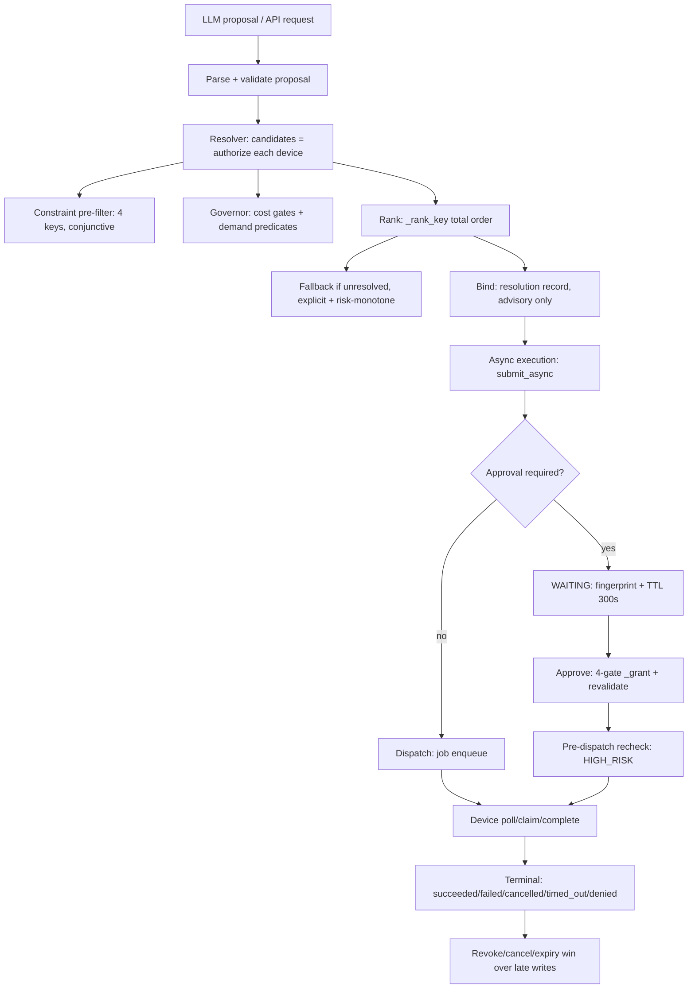
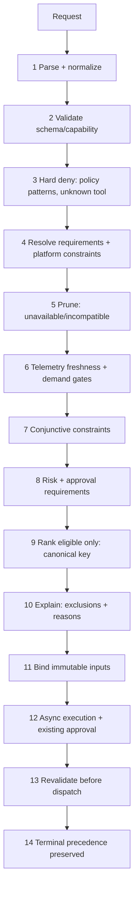

# CANONICAL SCHEDULER — architecture design (DESIGN ONLY)

**Status: DESIGN ONLY. Nothing here is implemented. No production or test
behavior changes in this task. No weights, no scores, no ranking changes.**

## 1. Executive summary and explicit non-goals

One canonical scheduler will eventually choose among already-eligible
candidates. It will not authorize, approve, grant trust, override
revocation, bypass policy, rank by hidden weights, migrate devices
automatically, or dispatch anything itself — it hands a bound plan to
the existing async execution + approval lifecycle, which revalidates at
fire time.

Non-goals in this task: any scheduler/ranking interface in production,
candidate-order changes, weights/thresholds, Governor v2, migration,
policy/risk/approval/authorization/binding changes, telemetry ingestion
changes, fabricated evidence, HIGH_RISK execution, dependencies,
Android/Linux runtime changes, calibration-golden edits, commit/push.

## 2. Current architecture inventory (file/function references)

**Rankers (4 orderings, diverged):**
- `CapabilityResolver._rank_key` (`core/resolver.py:404`) — 10-tuple:
  authorized, available, pinned, preferred, trust (7-level), presence
  (6-level), kind, −battery, −version, device_id asc. Sole caller
  `resolve` (`:466`). Only total/stable ordering.
- `FabricRegistry._rank` (`core/fabric.py:1180`) — (kind, presence
  online?, −battery); `device_id` tiebreak at call site (`:1119`).
  Caller: `route_capability` only.
- `Router.route` (`core/routing.py:50`) — (kind cloud<linux<android,
  device_id) over online-only devices; policy/governor sequential,
  first-proceed wins. Callers: `/v1/exec` path (`core/app.py:1706`),
  `Conversation._execute`.
- `DeviceManager.select` (`core/devices.py:198`) — same 2-key shape on
  enum; caller `GET /v1/devices/select`.
- Aux (not device rankers): `FallbackRegistry._risk_rank`
  (`resolver.py:158`), `_RISK_COST` floats (`fabric.py:554`),
  `_KIND_ORDER` (`fabric.py:553`, duplicated inline in routing/select
  with same values, three key types).

**Decision path (capability → dispatch):** discovery (`fabric.advertise`,
strict validate, full-snapshot replace) → `resolver.resolve` (normalize
constraints → cap/device checks → per-device `authorize_capability` →
`_rank_key` sort → `route_capability` cross-check → fallback ≤3) →
`authorize_capability` 13-step (`fabric.py:1023`: exists/trust/presence/
OS/policy/governor+demands) → `execute_on_device` (re-checks all +
governor → `engine.submit`) → async lifecycle (park/fingerprint/TTL/
revalidate/run) → device poll/claim/complete → terminal.

**Approval/binding:** fingerprint SHA-256/32 over
(tool,device,args,risk,capability,version); TTL 300 s with re-park;
4-gate `_grant`; HIGH_RISK pre-dispatch recheck; cancel→job wake;
terminal idempotence (expired never resurrects); revoke tombstones
persistent (when DB set).

## 3. Current decision-flow diagram



## 4. Proposed canonical pipeline diagram



Stage order rationale: deny-first (fail fast, no wasted trust/presence
work — note `Router`/`authorize` currently check exists→trust first; the
policy-pattern deny moves ahead without changing verdicts); telemetry
after prune (no measurement for already-dead candidates); rank last and
only over survivors. None change any verdict, only work-skipping.

Hard rejection vs deferral vs unknown: `deny` (policy/hard-deny/
revoked/unknown-tool) is terminal; `defer` (governor/offline/stale) is
retryable; `unknown` (telemetry) follows per-tier discipline (LOW
proceeds, MODERATE/HIGH defer); approval-required is a hold, not a
verdict. Ranking never converts deny→eligible.

## 5. Formal eligibility rules

```
eligible(c) ⟺
  exists(c.capability)                    # registry/descriptor lookup
  ∧ trust(c.device) ∈ EXECUTABLE_TRUST    # tombstone/auth/grant only
  ∧ presence(c.device) ∈ {online,degraded}# never stale/offline/unknown
  ∧ os_usable(c.descriptor)               # availability, not telemetry
  ∧ policy.decide(...) ∈ {allow, requires_approval}
  ∧ governor.check(snapshot, cost, risk, demands) ≠ defer
  ∧ constraints_match(c, normalized)      # 4-key conjunction
  ∧ ¬revoked ∧ ¬terminal-blocked
rank_input(c) = (authorized, usable, pinned?, preferred?, trust_rank,
  presence_rank, kind_order, −battery, −version, device_id)
```

Unknown/stale/unsupported per existing semantics: telemetry `None`→
unknown (LOW proceeds, MODERATE/HIGH defer); stale nulled at build
except battery/network legacy; platform gaps permanent-None;
`==bound` proceeds (strict `>`); fixed order memory→cpu→battery.
No silent zero, no healthy-inference, no permissive fallback.

## 6. Ranking comparison and provisional recommendation

Lexicographic tiers (keys above): total + stable via device_id, reason
per key position, unknown sorts last explicitly, starvation possible but
observable via pick counts, migration easy (already implemented as
`_rank_key`). Pareto: needs tiebreak anyway, weaker reasons, new code.
Weighted scores: stable only with fixed weights, opaque, require
imputation (forbidden), gameable, hard migration + evidence burden.

Provisional: **lexicographic tiers = current `_rank_key` promoted to
canonical**, owned by the scheduler module, other rankers delegating.
No numerical weights exist in evidence (Task-4: 0/39 calibration-
suitable); scores forbidden until N≥30 measured cells + derivation memo
+ divergence report exist. Starvation accepted with observability
(pick counts + substituted flag); fairness later only among
equally-authorized candidates.

## 7. Telemetry and evidence policy

Task-4 dataset (`docs/research/evidence/calibration_v1.jsonl`, 39
records: 31 synthetic / 6 replayed / 2 measured, 0 mismatches) is
regression evidence, not tuning fuel. Freshness: server clocks only
(`last_seen` presence, `last_telemetry_at` telemetry, 120 s); stale→
unknown at build; bare polls advance presence only. Provenance per
record (source/device_class/command); synthetic≠measured always labeled;
`calibration_suitable=false` until N≥30 independent samples per cell.
New observations append without rewriting history; out-of-order =
last-write-wins documented; secret scan + size caps enforced.

## 8. Concurrency and security invariants

Resolve→dispatch TOCTOU closed by: approve-time 4-gate `_grant`,
HIGH_RISK pre-dispatch recheck (extend to all scheduler fires),
fingerprint equality, TTL re-park, `cancel_by_execution` wake,
terminal idempotence, revoke linearization (queue-cancel first),
`Resolution`-as-plan (re-authorize at fire, TTL ≤300 s).
Scheduler type/lint gates: no `PolicyEngine.grant` import, no
`PolicyDecision(allow=True)` construction, no `registry.call` except
via engine after revalidation. Ranking mutations of approved action
forbidden. No new state machine; existing lifecycle reused.

## 9. Explainability schema (illustrative, NOT implemented)

```json
{"schema": "zara.sched-decision/v1", "request_id": "req-abc123",
 "capability": "system.battery", "eligible": [{"device_id": "emu-lab"}],
 "excluded": [{"device_id": "old-phone", "reason_code": "presence-offline"}],
 "telemetry": {"as_of": "2026-10-09T00:00:00+00:00", "stale": false},
 "constraints": {"platform": "", "risk_max": "safe"},
 "ranking": {"strategy": "lexicographic-v1", "tiebreak": "device_id-asc"},
 "chosen": "emu-lab", "approval_required": false,
 "revalidation": "pass", "execution_id": "exec-abc123"}
```

No secrets/credentials/raw payloads; device_ids coarse; reasons from
closed code list.

## 10. Compatibility and migration plan

Endpoints/wire shapes unchanged; resolver stays baseline; legacy rankers
kept until shadow comparison agrees ≥ threshold then delegate one by
one (fabric `_rank` first — narrowest). Shadow design: Core-side
operator-gated hook on legacy paths calling `resolve` read-only, emitting
`shadow_compare{legacy,resolver,match,reasons}` to audit/bus; exceptions
log-only; sample rate + kill-switch; compare (status-class, device,
approval_required). Rollback = config flag off; no migration, no
re-pair, no redeploy (no signature changes).

## 11. Rollback and feature-disablement

Single env flag defaulting legacy-live; `/resolve` 404/disabled when
off; audit counters confirm traffic return; Android/Linux need no
update (no required fields added).

## 12. Validation matrix

Determinism (20× repeat — exists), hard-vs-preference (new: assert rank
never flips deny), ties/unavailable/unknown/stale (exist), boundaries
(exist), conjunction (exist), all-LOW (exist), ranker divergence
(MISSING — needs 3-ranker comparison test), fingerprint immutability
(exists), binding/cancel/expire/revoke (exist), duplicates (missing —
needs idempotency-key test when added), stale-between-resolve-dispatch
(partial — needs scheduler-fire test), compat (exist), explanation
completeness (missing — needs schema-conformance test), disable/rollback
(missing — needs flag test).

## 13. Task-4 evidence limitations

N=1 measured cells; synthetic≠statistics; resolver goldens partly
self-referential; unavailable metrics absent; no stress/thermal data;
agreement≠optimality. Insufficient for weights (by design).

## 14. Open questions (must not be guessed)

1. Scheduler Tier-2 tiebreak weights — needs calibration set.
2. Fairness policy among equally-authorized candidates.
3. Stale-descriptor rank penalty magnitude.
4. Idempotency-key header design for duplicate submits.
5. Tombstone persistence default (memory-mode restart gap).
6. `parked_at` preservation across approval re-park (audit fidelity).
7. `online_only` default vs explicit in scheduler context.
8. Shadow agreement threshold for migration.

## 15. Implementation acceptance criteria

Single scheduler module; three rankers delegating (no independent
authority — prove by deleting call sites, suite green); determinism
goldens; explanation records validate; shadow agreement measured;
rollback drill logged; full suites green; no new required fields.

## 16. What remains unimplemented

Everything in §§4–11 except the already-existing `_rank_key` order:
scheduler module, explanation writer, shadow hook, idempotency key,
fairness, migration, weights (forbidden until evidence gates pass).
